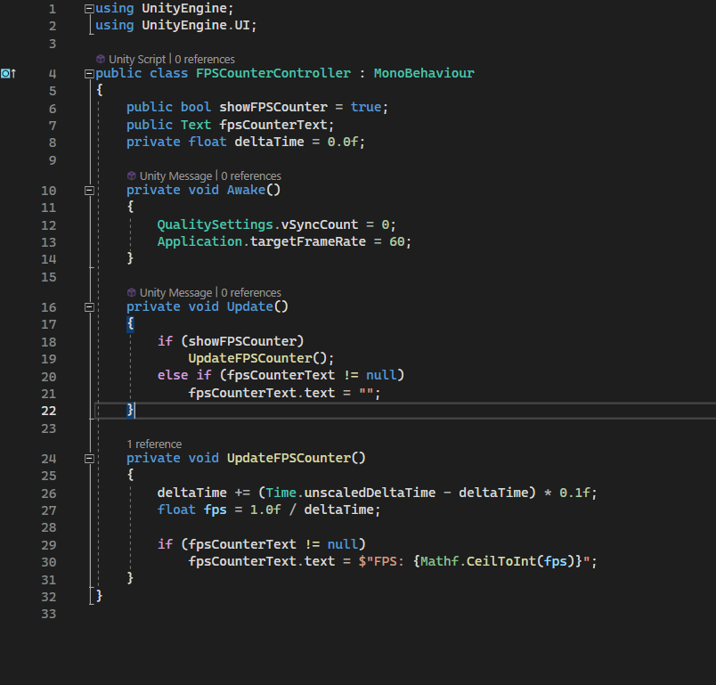

# Unity Toolbox

**Small, drop-in Unity scripts and editor tools for the problems you keep solving by hand.**

[](https://unity.com)
[](LICENSE)
[](https://github.com/AdeelGameDev/UnityToolbox/stargazers)
[](https://github.com/AdeelGameDev/UnityToolbox/releases)

Unity Toolbox is a curated set of the utilities I found myself rewriting on every
project — object pooling, singletons, slow motion, an FPS counter, UI anchor
fixing, bootstrap-scene automation, Android version-code bumping, missing-material
audits, wireless ADB, and more.

Every script is deliberately small and self-contained. Nothing here is a
framework. Take one file, or take the whole package.

---

## What's inside

### Runtime

| Tool | What it does |
|---|---|
| **[ObjectPool](Runtime/ObjectPool.cs)** | Pre-instantiates disabled clones and hands them out on demand, growing when the pool runs dry. |
| **[TimeManager](Runtime/TimeManager.cs)** | Slow motion that eases back to normal speed automatically, keeping `fixedDeltaTime` in sync so physics stays correct. |
| **[Singleton](Runtime/Singleton.cs)** | `Singleton<T>` and `SingletonPersistent<T>` base classes with correct duplicate handling. |
| **[PerformanceManager](Runtime/PerformanceManager.cs)** | Set VSync, target frame rate and screen sleep in one component instead of three `Awake` calls. |
| **[FPSCounterController](Runtime/FPSCounterController.cs)** | Live FPS readout in a UI `Text`, refreshed a few times a second so it costs almost no garbage. |
| **[NetworkEventManager](Runtime/NetworkEventManager.cs)** | Polls reachability and ping, then fires `OnNetworkConnected` / `OnNetworkDisconnected` on transitions. |
| **[InteractiveParticleOrb](Runtime/InteractiveParticleOrb.cs)** | Turns a `ParticleSystem` into a swirling sphere that reacts to and orbits the mouse cursor. |

### Editor

All under **Tools ▸ Unity Toolbox** in the menu bar.

| Tool | What it does |
|---|---|
| **[AnchorSmartFixer](Editor/AnchorSmartFixer.cs)** | Snaps selected UI elements to the nearest of nine anchor presets **without moving them on screen**. `Ctrl/Cmd + Shift + A`. |
| **[SceneBootstrapper](Editor/SceneBootstrapper.cs)** | Always start Play mode from the first scene in Build Settings, then restore the scene you were editing. |
| **[ComponentCollapser](Editor/ComponentCollapser.cs)** | Auto-collapses every component on selection — sanity for objects with 20 components. |
| **[EnterPlayModeToggle](Editor/EnterPlayModeToggle.cs)** | Flips Enter Play Mode Options on and off for fast iteration. |
| **[VersionCodeAutoIncrement](Editor/VersionCodeAutoIncrement.cs)** | Bumps `bundleVersionCode` before Android App Bundle builds so every Play Console upload is unique. |
| **[AutoConnectADB](Editor/AutoConnectADB.cs)** | Connect and disconnect wireless ADB devices from inside Unity. |
| **[AssetMaterialAudit](Editor/AssetMaterialAudit.cs)** | Finds renderers with empty or missing material slots across open scenes **and** every prefab. |

### Samples

Optional tools that need an extra package or a little setup. They live in
`Samples~/`, so they are **not compiled** until you import them — installing the
package can never break a project over a missing SDK.

| Sample | Needs |
|---|---|
| [Firebase Auth + Realtime Database](Samples~/FirebaseRealtimeDatabase/README.md) | Firebase Unity SDK |
| [QR Code Scanner](Samples~/QRCodeScanner/README.md) | ZXing.Net + TextMeshPro |
| [Input System Pinch / Scroll Zoom](Samples~/InputSystemPinchZoom/README.md) | Input System package |
| [Audio Manager](Samples~/AudioManager/README.md) | nothing — prefab included |
| [JSON Schema Migration](Samples~/JsonSchemaMigration/README.md) | Newtonsoft Json |
| [Android Keystore Password Automation](Samples~/AndroidKeystorePasswords/README.md) | nothing — Windows `.bat` |
| [Unity Library Cleaner](Samples~/UnityLibraryCleaner/README.md) | nothing — Windows `.bat` |

---

## Install

### Option A — Package Manager (recommended)

1. Open **Window ▸ Package Manager**.
2. Click **+** ▸ **Add package from git URL…**
3. Paste:

   ```
   https://github.com/AdeelGameDev/UnityToolbox.git
   ```

   To pin a version, append the tag:

   ```
   https://github.com/AdeelGameDev/UnityToolbox.git#v1.0.0
   ```

You can also add it by line to `Packages/manifest.json`:

```json
"com.adeel.unitytoolbox": "https://github.com/AdeelGameDev/UnityToolbox.git#v1.0.0"
```

### Option B — copy a single script

Every tool is a standalone file. Open the one you want, press **Raw**, copy it
into your project, done. Nothing in `Runtime/` depends on another file in this
repository except `Singleton.cs`.

### Option C — grab a sample

Install the package (Option A), then open
**Package Manager ▸ Unity Toolbox ▸ Samples** and import what you need. Each
sample carries its own README with setup steps.

> **Do not clone the repository into your `Assets` folder.** Unity would try to
> compile the samples and their third-party dependencies. Use the Package Manager.

---

## Requirements

- **Unity 2021.3** or newer.
- The core package has **no third-party dependencies**. It uses only built-in
  modules plus `com.unity.ugui`, which ships with every Unity project template.
- `InteractiveParticleOrb` uses the legacy `Input` API. If your project is set to
  "Input System Package (New)" only, switch Active Input Handling to **Both**.

---

## Screenshots

`FPSCounterController` in a scene:



---

## Design rules

This repository follows a few rules so the package stays safe to install:

- **`UnityEditor` never appears under `Runtime/`.** It would break player builds,
  so CI fails if it creeps in.
- **Optional dependencies live in samples.** Firebase, ZXing, Newtonsoft and the
  Input System are never required by the core package.
- **Everything is namespaced** (`Adeel.UnityToolbox` / `Adeel.UnityToolbox.EditorTools`)
  so nothing collides with your project's `Singleton`, `ObjectPool` or `TimeManager`.
- **One problem per tool.**

See [CONTRIBUTING.md](CONTRIBUTING.md) for the full list.

---

## Changelog

See [CHANGELOG.md](CHANGELOG.md) — v1.0.0 is the first formalised release and
includes breaking changes for anyone who copied files before it.

---

## License

[MIT](LICENSE) © Adeel Bashir

A few tools are adapted from public sources; attribution is kept in the file
header (for example `SceneBootstrapper` from Unity's
`com.unity.multiplayer.samples.coop`).

---

If a tool here saved you an afternoon, a ⭐ helps the next developer find it.
Suggestions and bug reports are welcome in
[Issues](https://github.com/AdeelGameDev/UnityToolbox/issues).
